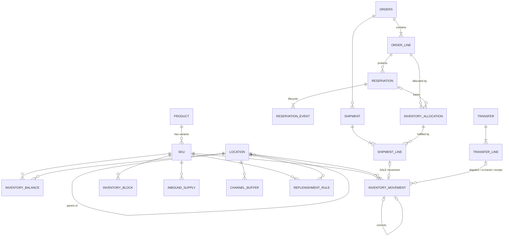

# Database Schema

PostgreSQL 16, managed by SQLAlchemy models (`backend/app/models/models.py`) and Alembic migrations (Stage 2).
Field-level detail: [data_dictionary.md](data_dictionary.md).

## ER diagram

## Relationships

| Type | Relationship |
|---|---|
| One-to-many | Product→SKU, Order→OrderLine, OrderLine→Reservation, Reservation→ReservationEvent, OrderLine→InventoryAllocation, Order→Shipment, Transfer→TransferLine, Location→Location (hierarchy) |
| Many-to-many | SKU↔Location (via `inventory_balance`); Shipment↔InventoryAllocation (via `shipment_line`) |
| One-to-one (optional) | ShipmentLine→SALE movement; TransferLine→each of its three movements; InboundSupply→RECEIPT movement |
| Optional FKs | `location.parent_location_id`, `inventory_movement.corrects_movement_id`, `allocation.reservation_id`, all `*_movement_id` links, `inventory_block.write_off_movement_id` |

## Lifecycle states

| Entity | States (allowed transitions) |
|---|---|
| Reservation | PENDING→CONFIRMED→CONSUMED; PENDING/CONFIRMED→EXPIRED; PENDING/CONFIRMED→CANCELLED. CONSUMED, EXPIRED, CANCELLED are terminal. |
| Order | NEW→RESERVED→ALLOCATED→(PARTIALLY_FULFILLED)→FULFILLED; any non-terminal→BACKORDERED (when unallocatable) or CANCELLED. FULFILLED and CANCELLED are terminal. |
| Transfer | DRAFT→DISPATCHED→IN_TRANSIT→ARRIVED→RECEIVED; DRAFT/DISPATCHED→CANCELLED |
| Shipment | PENDING→SHIPPED→DELIVERED; PENDING→CANCELLED |
| Block | ACTIVE→RELEASED or WRITTEN_OFF |
| Inbound | PLANNED→CONFIRMED→RECEIVED; PLANNED/CONFIRMED→CANCELLED |

## Effective dates

`sku` (`active_from` / `discontinued_on`), `replenishment_rule` and `channel_buffer` (`effective_from` / `effective_to`). A rule applies on date *d* if `effective_from <= d` and (`effective_to` is NULL or `effective_to >= d`).

## Integrity mechanisms

* **Immutable ledger:** `inventory_movement` is insert-only. Stage 2's migration adds a PostgreSQL trigger that raises on UPDATE/DELETE. Corrections are new rows (`CORRECTION`/`ADJUSTMENT`) with `reason` and `audit_ref`.
* **Duplicate prevention:** unique `idempotency_key` on movements and reservations.
* **Concurrency (Stage 3):** stock-changing services run in one transaction and lock the balance row with `SELECT ... FOR UPDATE`; `version` provides an optimistic check; CHECK constraints (`reserved + blocked <= on_hand`) are the last line of defence.
* **Indexes:** on every FK, plus `(sku_id, location_id, occurred_at)` for the ledger and `(status, expires_at)` for reservation expiry sweeps.
